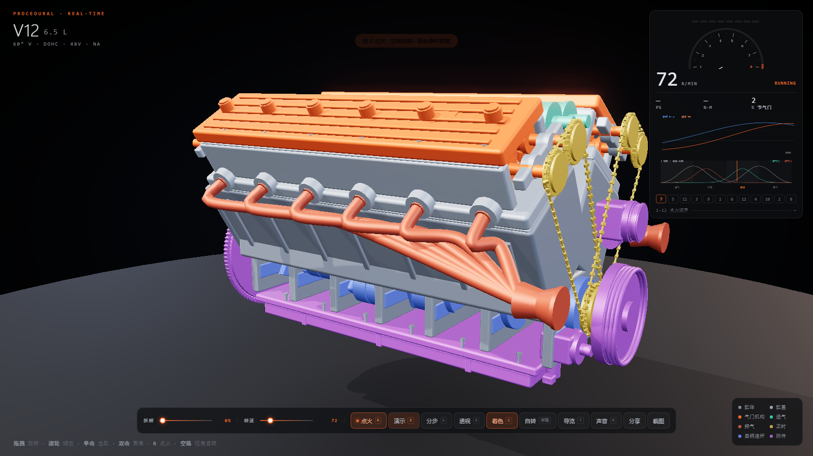

# V12 发动机 · 参数化运动与拆解演示

> 一台 6.5 L、60° V12、DOHC 48 气门的**参数化运动与交互拆解演示**，在浏览器里实时运行。活塞、连杆、曲轴、凸轮、气门弹簧、正时链、进排气歧管全部由代码生成形状，发动机声音也由代码合成 —— **仓库里没有任何外部资源文件**：没有 glTF/OBJ 模型、没有图片、没有 HDR 环境图、没有音频采样。
>
> 有纹理，但纹理也是代码画的：背景径向渐变、铸造颗粒、拉丝金属、可平铺噪声、火焰光晕等共 6 张，
> 都是启动时用 `<canvas>` 画出来再包成 `CanvasTexture`；环境反射由 `PMREMGenerator` 从程序化环境生成；
> 阴影是 `PCFSoftShadowMap` 实时阴影贴图。**"无外部资源"和"不使用纹理"是两件事**，这里是前者。
>
> 运行时唯一的第三方依赖是 **Three.js r161**，通过 importmap 从 unpkg CDN 加载，**需要联网**。
>
> *A real-time parametric motion and teardown demo of a 6.5 L 60° V12. All geometry and sound are generated in code — the repository ships no external assets: no glTF/OBJ models, no images, no HDR environment maps, no audio samples. Textures (6 procedurally drawn `<canvas>` textures) and the shadow map are generated at runtime; they are not third-party assets. Three.js r161 is loaded from a CDN at runtime, so a network connection is required.*


**[▶ 在线预览](https://wbapp-0h1wigjufzkz7jzgnjiu93.app.workbuddy.host/?sharecode=5ACYGHLV2H)**

| 拆解 100% | 透视 + 点火 | 系统着色 |
|---|---|---|
|  |  |  |

---

## 0. 这是什么，不是什么

| | |
|---|---|
| **是** | 曲柄连杆与配气机构的运动学演示；一个可交互、可拆解、可分享的视觉样机；一套程序化几何生成与实时渲染的实践 |
| **不是** | 工程分析工具。不做强度、热、润滑、流量、NVH 计算；不做装配公差与配合校核；不预测真实性能 |
| **不用于** | 制造、加工、选材、标定。尺寸只保证"代码里写的是这个数"，不保证"可以按这个数加工" |
| **没有对应实机** | 下表参数是**目标参数**，不是某台量产机的实测数据。原文写"真机"的地方已全部改为"目标参数" |

---

## 1. 参数与来源

`1 scene unit = 1 cm`，曲轴回转中心为原点，X 轴沿曲轴轴线，右列绕 X 轴 +30°、左列 −30°。

| 项 | 数值 | 来源 |
|---|---|---|
| 缸径 × 行程 | 95 × 76.4 mm | 需求规格书给定（`docs/SPEC.md`） |
| 曲轴回转半径 | 38.2 mm | 由行程推出：76.4 / 2 |
| 连杆中心距 | 145 mm | 需求规格书给定 |
| 缸心距 | 102 mm | 需求规格书给定 |
| V 角 | 60° | 需求规格书给定 |
| 排量 | 6.5 L | 由缸径行程反算：$12 \times \dfrac{\pi}{4} \times 9.5^2 \times 7.64 / 1000 \approx 6.498$ L，标称 6.5 L（缸径与行程取 cm，除以 1000 得 L） |
| 点火顺序 | 7-5-11-3-9-1-6-12-4-10-2-8 | 需求规格书给定 —— **当前几何排不出这个顺序**，见 §5.1 |
| 点火提前角 | 固定 30° BTDC | **为演示固定取值**，不是 ECU 标定 |
| 峰值扭矩 / 功率 | 715 N·m @ 7200 / 见 §5.3 | **手工高斯拟合的示意曲线**，无实测或公开数据来源 |
| 红线 / 滑块上限 | 7800 / 8300 r/min | 需求规格书给定 |

---

## 2. 跑起来

**推荐**：起一个本地静态服务（避免各浏览器对 `file://` 的 ES module 策略差异）。

```bash
python -m http.server 8142
# 浏览器打开 http://127.0.0.1:8142/index.html
```

**兼容选项**：直接双击 `index.html`。在允许 `file://` 加载远程模块的浏览器上可行，但不是通用保证。

```
index.html      唯一交付物，约 150 KB
docs/SPEC.md    原始需求规格书（18 条交互 + 声音模型，技术内容未改动）
docs/validation.md   运动学与碰撞检查：做了什么、怎么验的、哪里没有证据
docs/rendering.md    火焰、透明、镜像：渲染上的取舍与它们的真实原因
docs/debugging.md    "点拆解会卡死"的排查记录，含已确认与未确认的部分
shots/*.png     四个状态截图（无头 Edge 实拍）
```

调试句柄：控制台 `window.__v12` 暴露 `camera / controls / state / parts / scene / renderer / errs / THREE / camTween / stats`。

---

## 3. 本人实现 / 第三方依赖 / 数据与参考

**本人实现**
- 全部几何的程序化构造：`RoundedBox` / `Cylinder` / `Extrude`（凸轮桃形、扇形配重）/ `Tube`（贝塞尔歧管、排气头段）/ 自定义 helix 弹簧
- 曲柄连杆运动学解算、连杆姿态的正交基构造、链条沿包络曲线推进
- 火焰的体积着色器、程序化 fBm 噪声、可平铺噪声生成
- 声音的脉冲串合成模型（时域脉冲 → 傅里叶系数 → `PeriodicWave`）、离线 WAV 渲染
- 交互层：爆炸延迟、分步拆解、X-ray、系统着色、URL 状态编码、高清导出

**第三方依赖**
- `three@0.161`（MIT）及官方 addons：`OrbitControls`、`EffectComposer` / `RenderPass` / `UnrealBloomPass` / `OutlinePass` / `OutputPass` / `SMAAPass`、`RoundedBoxGeometry`、`BufferGeometryUtils.mergeGeometries`。全部从 unpkg 加载，不随仓库分发
- 仓库不含任何第三方模型、图片、HDR 环境图、音频采样；**程序化纹理与阴影贴图不算外部资源**，见开头那段

**数据与参考**
- 尺寸、交互清单、点火顺序：`docs/SPEC.md`（需求方提供）
- 点火提前角的数值区间（15~30° BTDC 自然吸气全负荷）：来自通用内燃机教材口径，**未附具体文献页码，请按经验值对待**
- 销长/销径比"目标机 0.8~1.25"：**无来源，属经验印象，未经核实**，不作为设计依据
- 功率扭矩曲线：本人手写的高斯函数，见 §5.3，不对应任何真实机型

---

## 4. 两项关键技术

### 4.1 运动学：显式正交基，而不是"转向目标向量"

活塞位置按曲柄连杆精确解算，不是正弦近似：

$$s(\theta) = r\cos\delta + \sqrt{L^2 - r^2\sin^2\delta},\qquad \delta = \theta + i\cdot 60° - 30°\sigma$$

符号定义（评审要求补全）：$r = 3.82$ cm 曲柄半径，$L = 14.5$ cm 连杆中心距，$\theta$ 是**曲轴自零位的转角（度，正向绕 +X 轴）**，$i \in \{0..5\}$ 是**列内几何序号（不是缸号、不是点火顺序位次）**，$\sigma = \pm 1$ 区分右/左列。$s$ 的参考点与方向：**从曲轴轴线沿缸轴向上量到活塞销中心**，单位 cm，所以 $s$ 最大值为上止点 18.32、最小值为下止点 10.68，行程 7.64。

缸号映射是另一套：`cylId(side, i) = side > 0 ? 12 - i : i + 1`，即右列 12~7、左列 1~6。

连杆姿态不用 `setFromUnitVectors(up, dir)`。那是"最小旋转"，一旦杆身方向带横向分量，连杆会绕自身轴滚一个角度，大头孔的轴就歪出曲拐销方向，整根杆看上去是拧的。改为显式搭正交基：

```js
_rx.set(1, 0, 0).addScaledVector(_dir, -_dir.x).normalize();  // 把 +X 投影成杆身横向基向量
_rz.crossVectors(_rx, _dir).normalize();
_basis.makeBasis(_rx, _dir, _rz);                              // 行列式 +1，无反射
```

大头孔的姿态单独 `quaternion.identity()` —— 大头环绕销轴对称，只对位、不带侧倾。

**这里要说清这是什么、不是什么。** 上面第一步是把 `+X` **投影**到垂直于杆身的平面上再归一化，
所以当 `_dir.x ≠ 0` 时，得到的 `_rx` **并不与曲拐销的 X 轴平行**（注释原先写"+X 贴住曲拐销轴向"，
不准确，已改）。它做的是：**为消除视觉穿插，把大头环与杆身分开控制姿态的示意处理**。

**没有验证刚体几何一致性。** 一根真实的偏置连杆是一个刚体，杆身、大头、小头的相对姿态由
一个统一变换决定；分开取姿态凑出"看起来不拧"，不等于两端孔轴都与销轴对齐。
所以不能说"这是真机 offset 连杆的做法"——真机的大头与曲柄销之间还需要**相对转动**，
"孔抱死销"这个说法也容易被读成锁死。要恢复这个说法，得先给出统一刚体变换，
并验证两端孔轴与销轴的对齐。

`setFromUnitVectors(up, dir)` 那条批评仍然成立：最小旋转会让杆身绕自身轴滚一个角度，
所以上面这套投影法在**视觉上**确实更好。区别在于它只是视觉处理，不是机械结论。

### 4.2 碰撞检查：面内采样，抓出四个真问题

活塞、连杆、曲轴挤在同一个曲轴箱里，同一根曲拐销上挂两根连杆。这类干涉**截图看不出来** —— 一千多帧里只有少数角度会穿，而且穿的往往是被遮挡的内侧。

做法：对每个三角面取面内采样点，变换进被检零件的局部坐标系，做实体包含判定，跑 8 个曲轴转角。

**结论必须限定**：这是"指定 8 个姿态、指定采样规则下未检出"，不是"全周期无穿模"证明。采样会漏掉窄小相交区，8 个角度也覆盖不到其余运动区间。**原始探针脚本没有入仓**，因此下表不可由仓库独立复现 —— 这是已知缺陷，详见 `docs/validation.md`。

它抓出的四个真问题（都已在当前版本修掉）：

| 问题 | 修法 |
|---|---|
| 曲轴里多铺一根贯穿轴心的圆柱，半径 2.9，到曲拐销轴线只有 3.82，而连杆大头外**半径** 3.15 —— 必然埋进去 | 删掉那根轴。轴向连续性改由"主轴颈 → 曲柄臂 → 销 → 曲柄臂 → 主轴颈"自己闭合 |
| 连杆杆身做成横向宽 3.0 的板（大头轴向厚 2.70，杆身反而更宽），同销两根只剩 0.21 间隙 | 杆身沿销轴的宽度收到 2.00（必须窄于大头 2.84），横向做 I 型断面 |
| 连杆大头跟着杆身一起侧倾 5.9°，同销两根的端面会"张嘴"互插 | 大头单独成一块、姿态不带侧倾 |
| 活塞裙做成带端面的实心圆柱，端面圆盘横切活塞冠 0.15 | 裙部与环带都改敞口筒（`open=true`）。真活塞围绕销是一片空腔 |

关于"顶点采样无效"的准确说法：**当前这种低轴向细分网格**的顶点采样会漏掉侧壁中段相交（一根长圆柱只在两端有顶点），所以加了面内采样。这不等于"顶点采样完全无效"，也不等于面内采样就完备。

---

## 5. 已知限制（都是量过之后写的，不是没做）

### 5.1 配气相位与活塞几何没有对齐 —— 当前最实质的缺陷

气门升程的相位取自**需求规格的点火顺序位次**：

```js
FIRING.forEach((n, i) => { CYL_PHASE[n] = i * 60; });   // 7-5-11-3-9-1-6-12-4-10-2-8
const peakIntake  = ph => ph + 450;
const peakExhaust = ph => ph + 250;
```

而活塞位置来自**几何序号** `i` 与列符号 `side`（§4.1 的公式）。两者是不同的编号体系，于是每个缸的"气门峰相对本缸压缩上止点的偏移"各不相同：

| 缸 | 1 | 2 | 3 | 4 | 5 | 6 | 7 | 8 | 9 | 10 | 11 | 12 |
|---|---|---|---|---|---|---|---|---|---|---|---|---|
| 排气峰偏差 | +240 | −120 | +240 | −120 | +240 | −120 | +180 | +60 | +300 | −180 | +60 | +300 |
| 进气峰偏差 | +225 | −135 | +225 | −135 | +225 | −135 | +165 | +45 | +285 | −195 | +45 | +285 |

判据不需要选定参考值：**一个自洽的模型里，12 缸的偏差应当是同一个常数**。实测：
**排气列 6 个不同余数、进气列 6 个、两列合起来 12 个**（单位：曲轴度），
没有一个能归一到同一常数，所以这套配气相位与活塞运动不对应。

区间要说清：上面的表格用**有符号** $[-360°,\,+360°)$，下面的脚本两种都打
（同一个值两边差 720 的整数倍：表格 $-120°$ 就是脚本的 $600°$）。复算脚本（不需要浏览器）：

```python
FIRING = [7,5,11,3,9,1,6,12,4,10,2,8]
PH = {n: i*60 for i, n in enumerate(FIRING)}
cylDa = lambda n: (-1, n-1) if n <= 6 else (1, 12-n)
sgn = lambda v: v - 720 if v > 360 else v      # [0,720) -> (-360,360]

rows = []
for n in range(1, 13):
    side, i = cylDa(n)
    tdc = (side*30 - i*60) % 720               # 这里的模 720 有问题，见下文「一个称谓要收回」
    e = (PH[n]+250 - (tdc+340)) % 720
    a = (PH[n]+450 - (tdc+555)) % 720
    rows.append((n, e, a))
    print("缸%2d  排气 %3d (%+4d)   进气 %3d (%+4d)" % (n, e, sgn(e), a, sgn(a)))

ex = {r[1] for r in rows}; iv = {r[2] for r in rows}
print("排气列不同值 %d 个：%s" % (len(ex), sorted(ex)))
print("进气列不同值 %d 个：%s" % (len(iv), sorted(iv)))
print("两列合计不同值 %d 个" % len(ex | iv))
```

实跑输出（2026-11-24）：

```text
缸 1  排气 240 (+240)   进气 225 (+225)
缸 2  排气 600 (-120)   进气 585 (-135)
...
排气列不同值 6 个：[60, 180, 240, 300, 540, 600]
进气列不同值 6 个：[45, 165, 225, 285, 525, 585]
两列合计不同值 12 个
```

**一个称谓要收回。** 上面 `tdc = (side*30 - i*60) % 720` 里，几何只决定**模 360° 的上止点**——
它区分不了四冲程里哪一圈是压缩、哪一圈是排气。取模 720 这一步实际上是**替它选了一套四冲程相位**，
不是从几何"反查"出来的。所以本节表格只该叫**"按本节规则选取的上止点"**，
不叫"本缸压缩上止点"；同理 §5.2 的火焰用另一套规则（`first = (m%2===0)?1:-1`）选压缩圈，
两处基准不同，**可能整体差 360°**。

**修法明确了但没做**（是一条，不是几条）：先建唯一一份 `compressionTdc[cylId]`
（各缸模 720° 的压缩上止点），让气门、火花、火焰、四冲程仪表**全部引用它**；
再补一张 720° 事件表（压缩上止点 / 进气开闭 / 排气开闭 / 点火角）作为验收依据。
只改气门 `ph` 对不齐火焰——那只是把两处不一致挪成一处。

### 5.2 点火顺序对不上，而且原来的解释是错的

旧版 README 写"要严格对上，必须把两列缸沿轴向错开半个缸距 —— 等于重做曲轴"。**这句话是错的，已删除。**

两列的轴向位置不影响上止点的曲轴角。点火顺序能否成立，取决于缸号定义、曲拐相位、连杆配对和四冲程相位这四件事，与轴向错开无关；轴向错开解决的是并列连杆的装配空间问题，跟角向相位是两个问题。

当前实现的真实情况：

- 火焰按曲拐几何驱动，`tdc = ((side*30 - i*60) mod 360)`，再按 §5.1 之外的一套规则选哪一圈是压缩上止点（`first = (m % 2 === 0) ? 1 : -1`，**这条规则没有配气证据支撑，是排布假设**）
- 实测 12 个火花角 = 0 / 60 / 120 / … / 660，严格 60° 间隔、每角唯一
- "每缸提前角精确 30°"是**构造性结论**：代码里 `spark = tdc - 30`，所以减出来必然是 30。这不是验证结果，是定义
- 实际点火次序 12-5-8-3-10-1-6-7-4-9-2-11，与需求的 7-5-11-3-9-1-6-12-4-10-2-8 不同

准确表述：**当前实现的缸号—曲拐相位映射不满足需求的点火顺序**，不是"物理不可能"。

**这个错位在 UI 上也能看见，而且格子的标签和实际高亮来自两套顺序。** 仪表盘底部那 12 个格子
（`#fire`，生成代码在 `index.html` 第 1822–1827 行）：

| 元素 | 按什么顺序 | 代码 |
|---|---|---|
| 格子里的**标签文字** | **需求顺序** `7-5-11-3-9-1-6-12-4-10-2-8` | `d.textContent = FIRING[i]` |
| `.nxt`（"下一个"描边） | **需求顺序**轮转 | `next = FIRING[Math.floor(state.crank/(60*DEG)) % 12]` |
| `.hot`（刚点火的实心块） | **几何实际**的缸号 | `hotCyl` 由点火事件写入 |

所以你会看到"实心块在闪，描边块却不一定在它左边一格"——这不是动画的错，是
**标签按需求、事件按几何**两个口径混在同一排格子里。它和 §5.1 的配气错位是同一个根：
**这套模型里没有一份统一的 720° 相位表**。

修法与 §5.1 合并：先建唯一一份 `compressionTdc[cylId]`，格子标签、`.nxt`、`.hot`、
气门、火焰全部引用它；在那之前，这 12 格只该当"按需求顺序排列的缸号牌"看，
**不要当作点火时序指示器**。

### 5.3 功率与扭矩是手工拟合的示意曲线

```js
const torqueAt = rpm => 715 * Math.exp(-Math.pow((rpm / 1000 - 7.2) / 5.6, 2));
const powerAt  = rpm => torqueAt(rpm) * rpm / 9549 * 1.35962;   // kW → PS
```

峰值 715 N·m @ 7200 r/min，功率由 $P = Tn/9549$ 换算成 kW 再乘 1.35962 显示为 PS（公制马力，**不是 hp**）。曲线形状是我选的，不对应任何真实机型，也没有燃烧/换气/摩擦模型支撑。

### 5.4 规模统计（实测口径，逐项区分）

一次 headless Edge 实测（`window.__v12.stats` 与场景遍历，见 §7）：

| 口径 | 值 | 说明 |
|---|---|---|
| 可交互分组 | **29** | `parts` 长度。是**分组**，不是机械零件件数（`piston` 一个分组里是 12 只活塞） |
| 场景 Mesh 对象 | **163** | 含 15 个 `InstancedMesh`；**实例不展开**，一个 InstancedMesh 记 1 |
| 实例总数 | **374** | 气门/弹簧/挺柱/螺栓/链条链板等 |
| 唯一 Geometry | **87** | 按 `geometry.uuid` 去重后的几何体个数（这个数不是 `stats` 给的，另算） |
| 三角形 · 普通 Mesh 按对象展开 | **229,280** | 非 `InstancedMesh` 的那部分（脚本里 `inst=1`） |
| 三角形 · `InstancedMesh` 按实例展开 | **100,384** | `几何三角形数 × instance count` |
| 三角形 · 场景展开合计 | **329,664** | 上两行相加 |
| 顶点 · 场景展开合计 | **874,704** | 同上，含实例复制 |
| position 缓冲 | 6,280,692 B ≈ 5.99 MiB | 只算位置属性 |

**这四行不是四种"测量"，是同一次遍历的四种归并。** 统计代码只有 6 行
（`index.html` 末段 `scene.traverse`）：对每个 `isMesh` 对象取
`index ? index.count : position.count`，再乘 `isInstancedMesh ? count : 1`。所以：

- **能算**：普通 Mesh 展开量、实例展开量、场景展开合计、Mesh 对象数、顶点数。
- **算不出**：按唯一 Geometry 去重后的三角形数（脚本没按 `geometry.uuid` 去重，87 是另一次统计的个数）。
- **更算不出"渲染实际提交量"**：那要算视锥剔除、可见性和 Outline/阴影等多 pass 的累计，
  本仓**没有帧级计数器**。原表的"提交量"这个词是错的，已改名为"场景展开合计"。

旧版 README 写的"139 个 Mesh / 约 29.8 万三角面"与代码自报的 `stats` 不符（代码自报 163 / 329,664），已按实测更正。

实例化零件**不逐帧重建几何**，只更新实例矩阵。曲轴、凸轮轴、活塞、连杆这些是逐帧重新计算的几何变换（不是骨骼、不是蒙皮）。

### 5.5 火焰只在透视模式显示

目标的"被不透明件遮挡、透过透明件可见"在这个场景里没做到。两组同机位对照：

1. `depthTest:true` + 非透视 → 整机视图**一点火光都没有**（缸盖、气门室盖、排气头段把燃烧室包死）
2. `depthTest:true` + 透视 → 火被压成一层淡桃子色（气门、凸轮、弹簧、活塞始终实心，正好挡在火前面）

所以在**当前单通道透明排序方案下**选择 `depthTest:false` + `renderOrder:8` 画在壳上面，代价是某些角度像浮在壳体表面。分层渲染、深度预处理、选择性遮挡都是可行替代方案，只是没做。

火焰体是**圆柱形燃烧空间示意**，高度每帧按活塞与缸盖间距算，但为可见性钳制了显示下限 —— 按 1 unit = 1 cm，0.55 的显示下限是 5.5 mm，会超出某些时刻的真实几何间隙。这个下限是视觉效果，不是燃烧室尺寸。

### 5.6 其他

- **正时盖板、张紧器、导轨都没有**，按需求方要求移除，链系常态敞开。真实发动机此处有盖板、导轨与液压张紧器
- **缸体是实体未剖切**，内部靠 X-ray 与拆解查看。剖切会引入"哪一面该显示"的判定，没做
- **左列不是几何镜像**：`bk(side, geo, x, y, z)` 的实现只有 `translate` + `rotateX(±30°)`，不含任何取反；镜像发生在**调用点的 z 参数**上（`7.6 * side` 这类写法），且所有部件都是按点重新生成几何，因此不存在顶点级反射与绕序翻转。详见 `docs/rendering.md`
- **未启用 SSAOPass**：与 Bloom / Outline 叠加性价比低，改用 `THREE.PCFSoftShadowMap`
  实时阴影贴图（`renderer.shadowMap`）。旧版这里写"接触阴影贴图"，用词不对——没有烘焙的
  接触阴影贴图，只有逐帧渲染的 shadow map
- **URL 分享只恢复 13 个参数**（爆炸值、机位球坐标 3 项、目标高度、X-ray、着色、分步步数、运行状态、转速、节气门、画质、选中件），**不恢复**声音开关、导览站、点火/火焰视觉状态、动画相位。详见 §7

---

## 6. 能做什么

| 交互 | 行为 |
|---|---|
| **运转** | 默认 72 r/min 慢转；转速滑块对数映射 30~8300（0 = 熄火）。低速端每格约 3%，压到 60 r/min 能看清单缸四冲程的每一冲 |
| **爆炸拆解** | 0–100%，**8 档延迟错峰**，逐档成员见下表；相机按 1+0.5t 自动后退 |
| **分步拆解** | 7 步（与上面的爆炸分组不同）：盖板与外部总成 → 正时链系 → 4 凸轮轴 → 气门组 → 缸盖+缸垫 → 活塞连杆 → 曲轴总成；支持 PageUp/PageDown 与点选跳转 |
| **透视 X-ray** | 外壳的不透明度设为 **0.10**（约 90% 透明、保留 10% 可见），内部保持实体；关闭阴影。可与爆炸、分步叠加 |
| **系统着色** | 8 大系统热图 + 图例：缸体 / 缸盖 / 气门机构 / 进气 / 排气 / 正时 / 曲柄连杆 / 附件 |
| **点火与仪表** | 点火后怠速 900 r/min，节气门映射到 8300。仪表含红线 7800 的转速表、示意功率扭矩曲线、1 号缸四冲程示意、点火顺序 12 芯片实时高亮 |
| **声音** | WebAudio 脉冲串模型合成，无采样。点火**事件重复频率** = rpm/10 Hz（V12 每 720° 点火 12 次）：怠速 90 Hz、红线 **780** Hz、滑块上限 830 Hz。这是点火事件率，不等于完整发动机声谱 |
| **导览** | 7 站：概览 → 正时 → 配气 → 曲柄连杆 → 燃烧与点火 → 进排气 → 回归整机 |
| **分享** | 编码 13 个参数进 URL hash，见 §5.6 与 §7 |
| **高清导出** | 截图 2K、Shift+截图 4K，自动合成带机型和日期的品牌条 |

键盘：`R` 点火 `X` 透视 `C` 着色 `S` 分步 `T` 导览 `E` 拆解演示 `M` 声音 `[ ]` 微调 `↑↓` 节气门 `空格` 自转 `Esc` 逐级退出。

**爆炸拆解的 8 档成员**（`delay` 字段，从 `index.html` 的 `newPart({...})` 定义解析得到；
代码里有 22 处 `newPart` 调用，左右列在 `for side` 循环里各生成一次，所以运行时 `parts.length = 29`）：

| 档 | `delay` | 这一档出来的零件 |
|---|---|---|
| 1 | `0.00` | 缸体 / 曲轴箱（不动，基准） |
| 2 | `0.02` | 气门室盖（左右列）、飞轮 + 离合器、扭转减振皮带轮、水泵/机油泵、干式油底壳 |
| 3 | `0.05` | 双稳压腔、等长进气歧管 ×12、独立节气门/喷油嘴 ×12、**排气头段**、紧固件 98 颗 |
| 4 | `0.12` | **凸轮轴 ×4**、链轮 ×5、双排正时链 |
| 5 | `0.22` | 气门组 48V、火花塞 / 点火线圈 ×12 |
| 6 | `0.32` | 缸盖（左右列）、缸垫（左右列） |
| 7 | `0.42` | 活塞 ×12、连杆 ×12 |
| 8 | `0.52` | 曲轴总成、主轴承盖 ×7 |

**这里没有"正时盖"这一档**——正时盖板按需求方要求整件移除（见 §5.6），旧版表格里
"进排气与正时盖"那一段是错的，已按 `parts` 的实际 `delay` 重写。
注意第 3 档里排气头段与进气系统同档、第 4 档里凸轮轴与链系同档，
旧版把它们并成"进排气与正时盖 → 链系与凸轮轴"两段，段数就少了一档。

---

## 7. 验证入口

想核对本文里的数字，按这几条走。

**规模统计**（需要联网加载 Three.js）

```bash
python -m http.server 8142
# 浏览器打开后，控制台执行：
#   __v12.stats            → { parts: 29, meshes: 163, tris: 329664, verts: 874704 }
#   __v12.errs             → 运行至今捕获到的异常数组
```

`stats.tris` 是**场景按实例展开的三角形合计**，既不是渲染提交量，也不是唯一 Geometry 的存储量——
三种口径的区别见 §5.4。本仓没有帧级计数器，测不出"实际提交了多少三角形"。

**配气相位错位**（不需要浏览器）：用 §5.1 的脚本，输出应当是**排气 6 个、进气 6 个**不同余数
（两列合起来 12 个）；若换成一致的映射，两列各自都应当归一到同一个常数。

**点火角**（不需要浏览器）：

```python
ADI, rows = 30, []
for side in (1, -1):
    for i in range(6):
        tdc = ((side*30 - i*60) % 360 + 360) % 360
        m = round((tdc - 30) / 60) % 6
        first = 1 if m % 2 == 0 else -1
        cyc = 0 if side == first else 1
        cyl = 12 - i if side > 0 else i + 1     # ← 几何序号换成缸号，不用读者自己换算
        rows.append(((tdc - ADI + cyc*360) % 720, cyl))
rows.sort()
print([c for _, c in rows])                                    # 实际点火次序（按缸号）
print([(rows[i+1][0] - rows[i][0]) % 720 for i in range(11)])   # 12 个角之间的间隔
```

实跑输出：

```text
[12, 5, 8, 3, 10, 1, 6, 7, 4, 9, 2, 11]
[60, 60, 60, 60, 60, 60, 60, 60, 60, 60, 60]
```

也就是**几何排出来的实际点火次序是 `12-5-8-3-10-1-6-7-4-9-2-11`**，间隔全 60，内部自洽；
它与需求规格的 `7-5-11-3-9-1-6-12-4-10-2-8` 不同。**UI 上那 12 个格子的标签写的是后者**
（`fireEl` 里 `d.textContent = FIRING[i]`），这是已知的错配，见 §5.2。

**URL 状态**：拖一下爆炸滑块、切一次 X-ray，看地址栏 hash。字段是 `e / a / p / d / ty / x / col / st / run / rpm / t / q / sel`；声音、导览、火焰状态不在里面。

**性能**：**本文不给帧时间数字。** 旧版写的"帧时间中位 6.1 ms / 控制台 0 报错"没有记录 CPU、GPU、浏览器版本、视口、DPR 和计时方法，不可复核，已撤下。自己在 `__v12.state` 打开的情况下用浏览器自带 Performance 面板量，由你记录条件。

---

## 8. 许可

代码与几何生成逻辑由本人实现，**MIT**（见 `LICENSE`）。

Three.js r161 及其官方 addons 为 MIT，通过 unpkg CDN 加载，不随仓库分发。

仓库不含任何第三方模型、图片、HDR 环境图或音频采样；用到的纹理（6 张）与阴影贴图都是运行时生成的，
不构成第三方资源。本文 §3 列出的"数据与参考"里，标了"未核实"的两项（点火提前角区间、销长径比范围）
不作为任何设计或工程结论的依据。
