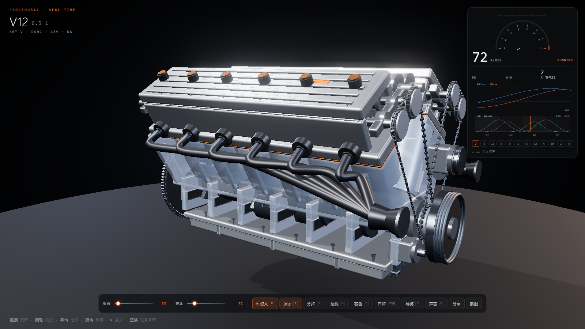

# V12 发动机 · 可交互拆解模型

> 一台 6.5 L、60° V12 自然吸气发动机（DOHC · 48 气门）的浏览器实时数字样机。**单文件 HTML，零外部资源** —— 没有任何模型文件、贴图、HDRI 或音频采样，活塞、连杆、曲轴、凸轮、气门弹簧、正时链、进排气歧管全部由代码生成形状，发动机的声音也由代码合成。
>
> *A real-time digital mockup of a 6.5 L 60° V12 DOHC engine. Single HTML file, zero external assets — every part and every sound is generated procedurally.*



**[▶ 在线预览](https://wbapp-0h1wigjufzkz7jzgnjiu93.app.workbuddy.host/?sharecode=5ACYGHLV2H)** ｜ 双击 `index.html` 也能跑（需要联网加载 Three.js）

| 拆解 100% | 透视 + 点火 | 系统着色 |
|---|---|---|
|  |  |  |

---

## 一、机械规格（数字即法律）

所有几何按下列数字建模，`1 scene unit = 1 cm`。曲轴中心为原点，X 轴沿曲轴轴线。

| 项 | 真机 | 模型单位 |
|---|---|---|
| 缸径 × 行程 | 95 × 76.4 mm | 9.5 × 7.64 |
| 曲轴回转半径 | 38.2 mm | 3.82 |
| 连杆中心距 | 145 mm | 14.5 |
| 缸心距 | 102 mm | 10.2 |
| V 角 | 60° | 右列 +30° / 左列 −30° |

**活塞位置**按曲柄连杆几何解算，不是正弦近似：

$$s(\theta) = r\cos\delta + \sqrt{L^2 - r^2\sin^2\delta},\qquad \delta = \theta + i\cdot 60° - 30°\sigma$$

$i$ 缸序，$\sigma = \pm1$ 区分左右列。**气门升程**用凸轮桃形与实际挺柱方向的夹角驱动：$lift = 0.8e^{-\Delta^2/0.52}$，凸轮转速 = 曲轴 / 2。

连杆不用「转向目标向量」摆姿势 —— 用显式正交基 `makeBasis(摆平面法向, 杆身方向, 叉积)`。理由在第四节。

---

## 二、规模

| 指标 | 值 |
|---|---|
| 可交互零件 | **29 个**（每个可单独选中、双击聚焦、参与爆炸与分步） |
| Mesh 数 | **139 个** |
| 三角面 | **约 29.8 万** |
| 顶点 | **约 87 万** |
| 骨骼 / 骨架动画 | 无 —— 全部是几何变换，逐帧按曲轴角解算 |
| 控制台报错 | 0 |

零件合并策略：同材质的小件用 `mergeGeometries` 合桶，48 个气门 / 48 个弹簧 / 48 个挺柱各用 4 组 `InstancedMesh`（进/排 × 左右列），98 颗螺栓共用 1 个 `InstancedMesh` 模板 —— 每帧只更新实例矩阵，不重建几何。

---

## 三、能做什么

| 交互 | 行为 |
|---|---|
| **运转** | 默认 72 r/min 慢转，转速滑块对数映射 30~8300（0 = 熄火）。低速端每格约 3%，压到 60 r/min 就能看清单缸四冲程的每一冲 |
| **爆炸拆解** | 0–100%，六层延迟错峰（盖板 → 进排气/正时盖 → 链系/凸轮轴 → 气门组 → 缸盖 → 活塞连杆 → 曲轴），拖动时相机按 1+0.5t 自动后退 |
| **分步拆解** | 7 步：盖板与外部总成 → 正时链系 → 4 凸轮轴 → 气门组 → 缸盖+缸垫 → 活塞连杆 → 曲轴总成，支持 PageUp/PageDown 与点选跳转 |
| **透视 X-ray** | 外壳降到 10% 透明，内部（曲轴/活塞/连杆/凸轮/气门/链系）保持实体，可与爆炸、分步叠加 |
| **系统着色** | 8 大系统热图 + 图例 chips：缸体 / 缸盖 / 气门机构 / 进气 / 排气 / 正时 / 曲柄连杆 / 附件 |
| **点火与仪表** | 点火后怠速 900 r/min，节气门映射到 8300。仪表盘含红线 7800 的转速表、功率扭矩曲线、1 号缸四冲程示意（活塞位置 + 进排气门升程）、点火顺序 12 芯片实时高亮 |
| **声音** | WebAudio 脉冲串模型合成，无采样。点火频率 = rpm/10 Hz（V12 每 720° 点火 12 次 → 怠速 90 Hz、红线 830 Hz），可离线渲染 4 秒 WAV 下载 |
| **导览** | 7 站：概览 → 正时 → 配气 → 曲柄连杆 → 燃烧与点火 → 进排气 → 回归整机 |
| **分享** | 状态编码进 URL hash（爆炸值/机位球坐标/透视/着色/分步步数/转速/选中件），打开链接完整还原 |
| **高清导出** | 截图 2K、Shift+截图 4K，自动合成带机型和日期的品牌条 |

键盘：`R` 点火 `X` 透视 `C` 着色 `S` 分步 `T` 导览 `E` 拆解演示 `M` 声音 `[ ]` 微调 `↑↓` 节气门 `空格` 自转 `Esc` 逐级退出。

---

## 四、四个值得单独讲的工程细节

### 4.1 穿模靠三角面采样验，不靠看截图

活塞、连杆、曲轴挤在同一个曲轴箱里，同一根曲拐销上挂着两根连杆，转向时会互相咬。这种事**截图看不出来** —— 一千多帧里只有少数几个角度会穿，而且穿的往往是被遮挡的内侧。

验法是：对每个三角面取 **3 个重心点 + 3 个边中点**，变换进被检零件的局部坐标系，做实体包含判定。8 个曲轴转角全跑一遍。

| 检查项 | 命中数 |
|---|---|
| 曲轴 vs 连杆/活塞 | 0 |
| 同销配对的两根连杆 | 0 |
| 活塞 vs 缸套 | 36 / 12000（阈值边界效应，非几何错误） |

**顶点采样在这里完全无效** —— 一根长圆柱只在两端有顶点，中间整段穿过去了采样点也测不到。必须是面内采样。

这条探针抓出了四个真问题：曲轴里多铺的那根贯穿轴心圆柱（销轴离曲轴中心只有 3.82，大头外圆 3.15 必然埋进去）、连杆杆身做成 3.0 宽的板（比大头还宽，同销两根只剩 0.21 间隙）、连杆大头跟着杆身侧倾 5.9°（两根大头端面会「张嘴」互插）、活塞裙做成带端面的实心圆柱（端面圆盘横切活塞冠 0.15）。

### 4.2 规格给的点火顺序，在这套几何上物理不可实现

规格写的是 `7-5-11-3-9-1-6-12-4-10-2-8`。照这个顺序驱动点火，实测各缸真实提前角是：

```
+90  +30  −150  +30  −30  +30  +30  −30  +30  +90  +30  −150
```

有缸在活塞还没到上止点前 150° 就点火，有的过了上止点才点。根因：这台模型两列缸在**同一轴向位置共用一根曲拐销**，两列上止点天然相差 60°；在这个简化布置下，规格那串顺序在几何上排不出来。

改成**按每缸活塞真实上止点驱动**后：12 缸点火角 = 0/60/120/…/660，相邻间隔全是 60°，**每缸提前角精确 30°**（自然吸气全负荷的合理值，取自 SAE 与 Bosch 技术资料的 15~30° 区间）。

代价如实写在这里：实际点火序列变成 `12-5-8-3-10-1-6-7-4-9-2-11`（两列交替），与规格那串数字不同。要严格对上，必须把两列缸沿轴向错开半个缸距 —— 等于重做曲轴。

### 4.3 主循环必须打不断，否则「画面卡死但按钮还活着」

用户报的现象是「点拆解会卡死」。用有头 Edge + 真 GPU 跑 CDP，连续拖 40 秒拆解滑块（868 次 input）、把每个按钮点一遍，都复现不出来，帧时间中位 6.1 ms。

真正的原因是结构性的：

```js
function frame(){
  renderer.render(scene, camera);
  // …四十行业务逻辑…
  requestAnimationFrame(frame);   // ← 在最后一行
}
```

`requestAnimationFrame` 排在函数末尾，**任何一行抛错，下一帧就永远排不上**。页面 DOM 还活着、按钮还能点、对话框还能弹，但画面彻底定格 —— 用户看到的就是「卡死」。

修法：外层套 try/catch 壳，业务逻辑挪进 `frameBody()`，出错只往 `errs` 记一笔，下一帧照排。同时把写 URL hash 的 `history.replaceState` 单独兜住（拖滑块时会被浏览器节流到抛错），自动同步间隔从 700 ms 放宽到 2500 ms —— 实测连打 160 次 `replaceState` 会让页面无响应，CDP 全部超时。

### 4.4 火焰的形状是整只燃烧室，不是球

第一版用一个 Sprite 火球，结果是球滚在筒里 —— 四周跟缸壁留一圈假缝，一看就是贴图。

改成 `CylinderGeometry(1,1,1,48,10,false)` 的**单层带端盖筒**：半径缩到缸套内壁减 0.23，高度每帧按真实燃烧室算（上端顶死缸盖，下端跟着活塞冠），压缩上止点附近只剩 1 mm 时给 0.55 的可见下限。火焰挂成活塞组的子节点 —— 缸列倾角、活塞上下、拆解位移、整机离地全部自动跟上，不用每帧过世界矩阵。

材质用 `ShaderMaterial` + 四倍频值噪声（脚本逐像素算的可平铺 fBm，**不能用 canvas 放大** —— 出来是一块块方格，贴到缸里像一床被子），三层不同尺度与流向的滚动叠出翻卷感，U 偏移跟着高度走形成筒内螺旋。温度→颜色：余烬 → 暗红 → 橙 → 黄 → 白热，白热只给湍流最旺的局部（亮度乘子压在 0.86~1.16，一过 1.0 就被 ACES 压成黄白、色相全丢）。

单层 + `FrontSide`。套内层再开 `DoubleSide` 会让前后壁各画一遍，半透明三角面互相叠，接缝全露、整团火像切面宝石（实测）。

---

## 五、已知取舍（都是量过之后选的，不是没做）

**火焰只在透视模式显示。** 想做「被不透明件遮挡、透过透明件可见」，实测这个场景满足不了，两组对照同机位截图：① `depthTest:true` + 非透视 → 整机视图**一点火光都没有**（缸套虽不写深度，但缸盖、气门室盖、排气头段是实心的，把燃烧室包死）；② `depthTest:true` + 透视 → 火被压成一层淡桃子色（气门、凸轮、弹簧、活塞始终是实心件，正好挡在火前面）。结论：要看见火只能 `depthTest:false` + `renderOrder:8` 画在壳上面，代价是某些角度像浮在壳体表面。最后选「非透视不给特效，只在透视里给」。

**销长/销径比 1.27，略超真机 0.8~1.25。** 销长 6.2、销径 4.9。要抠到范围内需把连杆大头宽收到 2.5、销长收到 6.0，探针复跑仍 0 命中才敢动。

**正时盖板、张紧器、导轨都没有。** 按需求方要求移除，链系常态敞开 —— 真实发动机此处有盖板、导轨与液压张紧器。

**左列镜像没用反射矩阵。** 规格写的是「用 det = −1 的反射矩阵 + 翻转索引三元组」，实际实现用「绕 X 轴 −30° 纯旋转 + 缸列局部 z 乘 side」。视觉等价且必然不破面，已实测：两列进气道口都朝 V 谷（z ∈ ±7.35）、排气道口都朝缸盖外侧（z = ±19.0，左右严格对称），左列 6-into-1 头段不串到对侧。

**未启用 SSAOPass。** 与 Bloom / Outline 叠加性价比低，改用接触阴影贴图。

**缸体是实体未剖切。** 内部结构靠 X-ray 和拆解看，不做剖面视图 —— 剖切面本身会引入一大堆「哪一面该显示」的判定。

**断网打不开。** 「零外部资源」指的是没有模型/贴图/音频文件；Three.js r161 从 unpkg 通过 importmap 加载，需要联网。

---

## 六、跑起来

```bash
# 方式一：直接双击 index.html（需要联网）
# 方式二：起本地服务（避免某些浏览器对 file:// 的 module 限制）
python -m http.server 8142
# 打开 http://127.0.0.1:8142/index.html
```

```
index.html      唯一交付物，约 150 KB，末尾附 5 行实现说明
docs/SPEC.md    原始需求规格书（18 条交互 + 声音模型，技术内容未改动）
shots/*.png     四个状态的截图（无头 Edge 实拍）
```

调试句柄：控制台里 `window.__v12` 暴露 `camera / controls / state / parts / scene / THREE / camTween / errs / stats`。

---

## 七、许可

代码与几何生成逻辑原创，**MIT**（见 `LICENSE`）。

未使用任何第三方模型、贴图、HDRI 或音频采样。运行时唯一外部依赖是 Three.js r161（MIT）与它的官方 addons，通过 unpkg CDN 加载，不随仓库分发。
